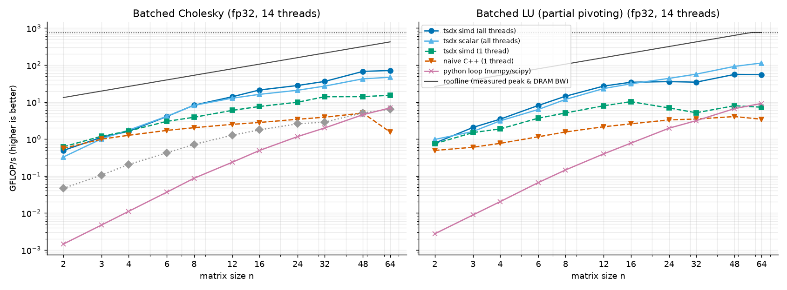

# TinySolverDx — batched small-matrix Cholesky/LU with a numerical error lab

A C++17 library of batched small-matrix solvers (Cholesky, LU with partial pivoting) with register-/cache-friendly
kernels, an optional CUDA backend, Python bindings for NumPy arrays, and a reproducible analysis of **accuracy vs.
speed across precisions** (fp16/bf16 emulation, fp32, fp64) against a long-double ground truth.

> CV line: *Implemented batched Cholesky/LU in C++/CUDA with Python bindings; ~18× faster than looped NumPy/SciPy for
> 32×32 fp32 matrices (measured on a 14-thread aarch64 CPU, see below), with documented floating-point error analysis.*
> The CUDA backend is written but was **not compiled or run** in the environment that produced these results (no GPU/nvcc).

## Headline charts

**Throughput vs. size** (fp32; fp64 chart: `docs/report/roofline_fp64.png`) — roofline-style: GFLOP/s per size, with the
ceiling `min(peak, bandwidth × arithmetic intensity)` from measured machine probes:



**Backward error vs. condition number** for every precision (per-precision plots incl. forward error and failure rate:
`docs/report/error_vs_cond_<prec>.png`, tables in [`docs/report/REPORT.md`](docs/report/REPORT.md)):


Together they make the point of the project: the fast kernels are also *accurate* — backward error stays at the unit
roundoff `u` for every precision regardless of conditioning, forward error follows `κ·u`, and Cholesky in low precision
fails (`info > 0`) once `κ·u` approaches 1.

### Measured numbers (n = 32, fp32, 14 threads)

| | Cholesky GFLOP/s | LU GFLOP/s |
|---|---|---|
| TinySolverDx best backend (all threads) | 36 (SIMD) | 57 (scalar) |
| TinySolverDx SIMD, 1 thread | 14 | 5 |
| naive C++ baseline, 1 thread | 3.9 | 3.5 |
| `np.linalg.cholesky` on the whole stack | 2.9 | – |
| Python loop of NumPy/SciPy calls | 2.0 | 3.1 |

Speed-up vs. the Python loop: 18× (n=32), 43× (n=16), 10–12× (n=64). Caveats, stated plainly: the library numbers use all
14 threads while the baselines are single-threaded (the "1 thread" rows isolate the kernel gain: ~3.5× for Cholesky
over the naive baseline); sandbox timing is noisy; very small n is limited by the AoS↔interleaved gather (n=2 is ≈1 GFLOP/s).
Raw data: `docs/report/bench_fp32.csv`, `bench_fp64.csv`. Reproduce with `make bench`.

## Features

* Batched **Cholesky** and **LU with partial pivoting** for n = 1…64 (spec: 2–64), templated on matrix size and precision.
* Precisions: fp32, fp64, and **fp16 / bfloat16 emulated on the CPU** (round-to-nearest-even after every operation).
* **CPU backends** (always built/tested): `naive` (textbook baseline), `scalar` (per-matrix, compile-time-N kernels
  for n ≤ 16), `simd` (W matrices interleaved per tile so every arithmetic op vectorizes across the batch), threaded via
  OpenMP when available, `std::thread` otherwise.
* **CUDA backend** (built only if `nvcc` is found): one matrix per thread for n ≤ 16, one matrix per block in shared
  memory for n ≤ 64.
* Triangular solves, `posv`/`gesv` one-shot drivers, multiple right-hand sides.
* **Python bindings** (pybind11) on NumPy arrays; tested against `numpy.linalg` and `scipy.linalg`.
* **Error lab** (`tinysolverdx.lab`): backward-error / forward-error / failure-rate sweeps over condition number and size,
  vs. a long-double reference, with plots per precision and a generated Markdown report.
* **Benchmarks**: roofline-style chart (`tinysolverdx.bench`) and Google Benchmark micro-benchmarks (`tsdx_bench`).

## Architecture

```
include/tinysolverdx/
  precision.hpp   Precision/Backend enums, fp16/bf16 emulation (Emu<>), unit roundoff
  kernels.hpp     single-matrix + interleaved-tile Cholesky/LU kernels, triangular solves (HD-annotated, shared with CUDA)
  batched.hpp     batch drivers, compile-time-N dispatch tables, backend selection, chunked parallelism
  parallel.hpp    parallel_for (OpenMP or std::thread)
  tinysolverdx.hpp  runtime-precision API, long-double reference/metrics, peak/bandwidth probes
  cuda_backend.hpp
src/runtime.cpp          runtime precision dispatch, ground truth, probes
src/cuda/cuda_backend.cu thread-per-matrix and block-per-matrix kernels
src/python/bindings.cpp  pybind11 module `_core`
python/tinysolverdx/     NumPy-facing API (__init__), matrices.py, lab.py, bench.py
tests/cpp  tests/python  GoogleTest and pytest suites
bench/bench_cpu.cpp      Google Benchmark
docs/report/             generated reports, CSVs and charts; docs/demo.ipynb
```

Data layout: `(batch, n, n)` row-major, matrices contiguous. Cholesky returns the lower factor (upper zeroed); LU returns
packed L\U plus LAPACK/SciPy-style 0-based sequential pivots, so results are directly comparable with
`scipy.linalg.lu_factor`. Failures follow LAPACK: `info = k` is the 1-based first non-positive Cholesky pivot / zero LU pivot
(factor contents are unspecified for failed Cholesky matrices).

## Setup

Requires a C++17 compiler, CMake ≥ 3.20 and Python ≥ 3.9. GoogleTest, Google Benchmark are found on the system or
fetched with CMake `FetchContent` (network needed once).

```bash
make setup          # creates .venv, installs numpy/scipy/matplotlib/pybind11/pytest + cmake/ninja
make build          # CMake configure + build (library, extension, tests, benchmarks)
```
(`make build CXX=clang++` or `export CXX=...` to choose a compiler; `JOBS=2` limits parallel compile jobs — the
template instantiations are memory hungry.) Without `make`:
`cmake -S . -B build -G Ninja -DPython_EXECUTABLE=$(which python) && cmake --build build`.

### Building with or without CUDA

CUDA is **automatic**: CMake runs `check_language(CUDA)`; if `nvcc` exists the CUDA backend is compiled in
(`TSDX_WITH_CUDA`), `has_cuda()` reports whether a device is visible, and `backend="cuda"` becomes available.
Without a toolchain the build is CPU-only and `backend="cuda"` raises `RuntimeError`. Force CPU-only with
`-DTSDX_ENABLE_CUDA=OFF`; choose architectures with `-DCMAKE_CUDA_ARCHITECTURES=80`. `Backend::Auto` always means CPU,
because the API takes host pointers (the CUDA path copies to/from the device, so it is a correctness/integration
path, not a transfer-free one). CUDA tests (`Cuda.MatchesCpuWhenAvailable`, `test_cuda_matches_cpu_if_available`) skip when
no device is present.

Other options: `-DTSDX_NATIVE=OFF` (portable codegen instead of `-march=native`), `-DTSDX_BUILD_TESTS/BENCH/PYTHON=OFF`.
Config via environment (see `.env.example`; none are secrets): `TSDX_NUM_THREADS`, `TSDX_SEED`, `TSDX_OUT_DIR`.

## Run

```python
import numpy as np, tinysolverdx as tsdx          # PYTHONPATH=python (the Makefile sets it)
A = ...                                          # (batch, n, n) float32/float64/float16, 1 <= n <= 64
L, info = tsdx.cholesky(A)                       # lower factors
LU, piv, info = tsdx.lu(A, backend="simd")       # backends: auto, naive, scalar, simd, cuda
x, info = tsdx.posv(A_spd, b)                    # b: (batch, n) or (batch, n, nrhs)
x, info = tsdx.gesv(A, b)
L, _ = tsdx.cholesky(A.astype(np.float32), precision="bf16")   # emulated bfloat16 (float32 carrier)
```
`docs/demo.ipynb` is a short walk-through (looped-NumPy comparison + per-precision accuracy). Reports:

```bash
make report         # error lab  -> docs/report/REPORT.md, error_vs_cond_*.png, backward_error_vs_*.png, CSVs
make bench          # benchmarks -> docs/report/roofline_fp32.png / fp64.png, bench_*.csv
.venv/bin/python -m tinysolverdx.lab --quick     # fast smoke run
build/tsdx_bench                                  # Google Benchmark micro-benchmarks
```

## Test

```bash
make test           # ctest (GoogleTest, 19 tests) + pytest (111 tests)
```
C++: all sizes 1–64 × all CPU backends × fp32/fp64 against long-double backward-error bounds, fp16/bf16 rounding
(ties-to-even, subnormals, overflow), failure `info`, SIMD tail batches, backend agreement, thread-count
independence, solves vs. reference. Python: NumPy/SciPy comparisons (factors, pivots, solves), dtype/shape/error
handling, emulated precisions, error-metric sanity, and a smoke run of the lab and benchmark scripts.

## Key design decisions

* **Interleaved tiles for SIMD.** Small matrices don't offer enough intra-matrix parallelism, so the `simd` backend
  transposes W (8 fp32 / 4 fp64) matrices into a lane-interleaved tile and vectorizes across the batch; each tile stays in
  L1/L2 (the CPU analogue of "register/shared-memory-friendly"). The gather/scatter is included in all timings.
* **LU pivoting is divergent across lanes**, handled with per-lane row swaps (O(n) vs. O(n²) update). Measured: from
  n ≈ 32 the plain per-matrix kernel is faster, so `Backend::Auto` switches to `scalar` for LU above n = 24.
* **Compile-time N only where it pays**: sizes ≤ 16 get fully specialized kernels via dispatch tables; larger sizes share one
  runtime-N kernel to bound compile time and code size.
* **Emulated fp16/bf16 round after every operation** (no wider accumulator) — a worst-case model that exposes the
  low-precision behaviour; it is slow by design and not a performance backend.
* **Ground truth is `long double`** (80-bit on x86, 128-bit on aarch64) rather than Boost.Multiprecision, to avoid a
  dependency. Residuals are evaluated in long double; the reference solve error is ≥ 2000× below fp64's, which is what the
  forward-error plots need (condition numbers are capped at 1e12).
* **Error lab methodology**: inputs are rounded to the target precision first, so the algorithm — not the input rounding —
  is what's measured; matrices have prescribed 2-norm condition number (orthogonal factors × geometric spectrum).
* Normwise Frobenius backward errors are reported; failures are counted, not hidden, and medians use successful factorizations only.

## Known limitations

* CUDA backend is untested here (no nvcc/GPU available when this was built) and stages data through host memory.
* The environment used OpenMP-less `std::thread` parallelism (`has_openmp()` is false there); the OpenMP path is compiled
  only when CMake finds OpenMP.
* Benchmarks come from one shared aarch64 sandbox; treat absolute GFLOP/s as indicative and rerun `make bench` on your machine.
* Solves are straightforward per-matrix substitution (not tiled/vectorized across the batch).
