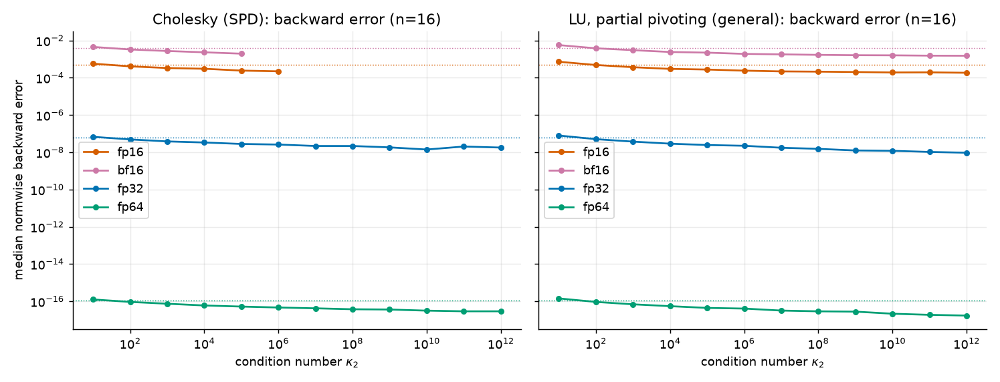
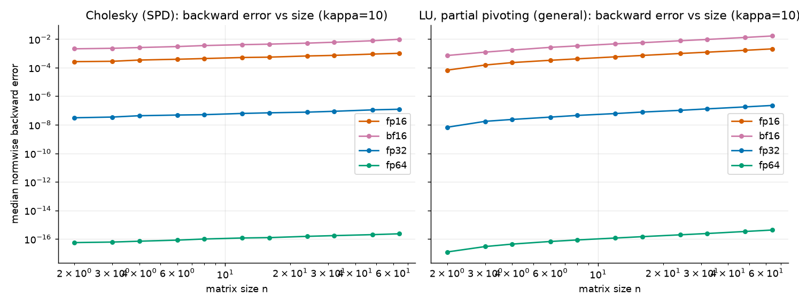
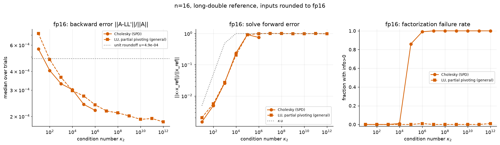
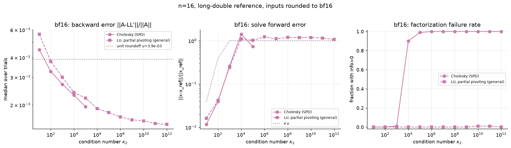
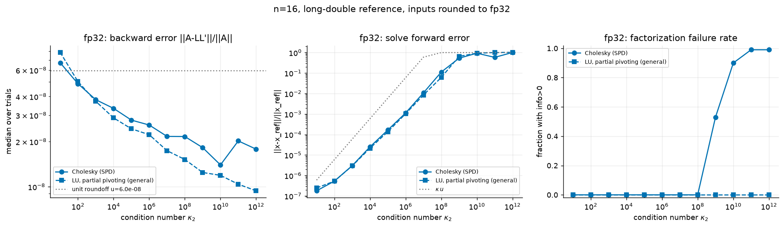
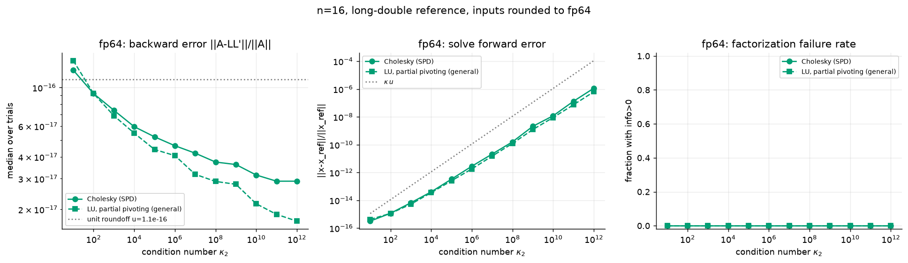

# TinySolverDx numerical error report

Generated by `python -m tinysolverdx.lab` (seed=0, 100 matrices per point, n=16 for the condition sweep). Matrices are built with a prescribed 2-norm condition number, rounded to the target precision, factored by the library (fp16/bf16 emulate per-operation rounding on the CPU) and compared with a long-double reference (`reference_solve`, residuals in long double).

Metrics: backward error `||A-LL^T||_F/||A||_F` (Cholesky) and `||PA-LU||_F/||A||_F` (LU); solve forward error `||x-x_ref||_2/||x_ref||_2`; failure rate = fraction of matrices with `info>0` (non-positive pivot / zero pivot). Medians are over successful factorizations.

## fp16 (u = 4.88e-04)

| kappa | chol backward | chol forward | chol fail | LU backward | LU forward | LU fail |
|---|---|---|---|---|---|---|
| 1e+01 | 5.66e-04 | 1.47e-03 | 0.00 | 7.18e-04 | 2.02e-03 | 0.00 |
| 1e+02 | 4.06e-04 | 4.88e-03 | 0.00 | 4.81e-04 | 5.58e-03 | 0.00 |
| 1e+03 | 3.31e-04 | 2.59e-02 | 0.00 | 3.65e-04 | 2.70e-02 | 0.00 |
| 1e+04 | 3.02e-04 | 2.39e-01 | 0.01 | 2.97e-04 | 2.03e-01 | 0.00 |
| 1e+05 | 2.40e-04 | 9.24e-01 | 0.86 | 2.74e-04 | 9.13e-01 | 0.00 |
| 1e+06 | 2.19e-04 | 7.52e-01 | 0.99 | 2.39e-04 | 9.94e-01 | 0.01 |
| 1e+07 | - | - | 1.00 | 2.17e-04 | 1.01e+00 | 0.00 |
| 1e+08 | - | - | 1.00 | 2.11e-04 | 1.00e+00 | 0.00 |
| 1e+09 | - | - | 1.00 | 2.01e-04 | 9.94e-01 | 0.00 |
| 1e+10 | - | - | 1.00 | 1.91e-04 | 9.87e-01 | 0.00 |
| 1e+11 | - | - | 1.00 | 1.94e-04 | 9.98e-01 | 0.00 |
| 1e+12 | - | - | 1.00 | 1.84e-04 | 9.82e-01 | 0.01 |

## bf16 (u = 3.91e-03)

| kappa | chol backward | chol forward | chol fail | LU backward | LU forward | LU fail |
|---|---|---|---|---|---|---|
| 1e+01 | 4.48e-03 | 1.17e-02 | 0.00 | 5.64e-03 | 1.62e-02 | 0.00 |
| 1e+02 | 3.26e-03 | 3.96e-02 | 0.00 | 3.78e-03 | 4.16e-02 | 0.00 |
| 1e+03 | 2.71e-03 | 2.60e-01 | 0.01 | 3.00e-03 | 2.45e-01 | 0.00 |
| 1e+04 | 2.31e-03 | 1.42e+00 | 0.90 | 2.40e-03 | 1.10e+00 | 0.00 |
| 1e+05 | 1.95e-03 | 7.40e-01 | 0.99 | 2.21e-03 | 1.02e+00 | 0.00 |
| 1e+06 | - | - | 1.00 | 1.90e-03 | 1.23e+00 | 0.00 |
| 1e+07 | - | - | 1.00 | 1.79e-03 | 1.11e+00 | 0.00 |
| 1e+08 | - | - | 1.00 | 1.68e-03 | 1.19e+00 | 0.00 |
| 1e+09 | - | - | 1.00 | 1.61e-03 | 1.19e+00 | 0.00 |
| 1e+10 | - | - | 1.00 | 1.59e-03 | 1.19e+00 | 0.01 |
| 1e+11 | - | - | 1.00 | 1.52e-03 | 1.15e+00 | 0.01 |
| 1e+12 | - | - | 1.00 | 1.51e-03 | 1.07e+00 | 0.00 |

## fp32 (u = 5.96e-08)

| kappa | chol backward | chol forward | chol fail | LU backward | LU forward | LU fail |
|---|---|---|---|---|---|---|
| 1e+01 | 6.72e-08 | 1.79e-07 | 0.00 | 7.89e-08 | 2.46e-07 | 0.00 |
| 1e+02 | 4.87e-08 | 5.31e-07 | 0.00 | 5.03e-08 | 5.31e-07 | 0.00 |
| 1e+03 | 3.81e-08 | 3.02e-06 | 0.00 | 3.71e-08 | 2.95e-06 | 0.00 |
| 1e+04 | 3.33e-08 | 2.50e-05 | 0.00 | 2.88e-08 | 2.16e-05 | 0.00 |
| 1e+05 | 2.78e-08 | 1.66e-04 | 0.00 | 2.43e-08 | 1.37e-04 | 0.00 |
| 1e+06 | 2.58e-08 | 1.13e-03 | 0.00 | 2.22e-08 | 1.03e-03 | 0.00 |
| 1e+07 | 2.17e-08 | 1.08e-02 | 0.00 | 1.74e-08 | 8.50e-03 | 0.00 |
| 1e+08 | 2.16e-08 | 1.12e-01 | 0.00 | 1.52e-08 | 6.09e-02 | 0.00 |
| 1e+09 | 1.82e-08 | 5.30e-01 | 0.53 | 1.25e-08 | 6.53e-01 | 0.00 |
| 1e+10 | 1.40e-08 | 9.30e-01 | 0.90 | 1.19e-08 | 9.31e-01 | 0.00 |
| 1e+11 | 2.02e-08 | 5.83e-01 | 0.99 | 1.04e-08 | 1.00e+00 | 0.00 |
| 1e+12 | 1.78e-08 | 1.01e+00 | 0.99 | 9.39e-09 | 1.03e+00 | 0.00 |

## fp64 (u = 1.11e-16)

| kappa | chol backward | chol forward | chol fail | LU backward | LU forward | LU fail |
|---|---|---|---|---|---|---|
| 1e+01 | 1.26e-16 | 3.16e-16 | 0.00 | 1.43e-16 | 4.17e-16 | 0.00 |
| 1e+02 | 9.23e-17 | 1.15e-15 | 0.00 | 9.23e-17 | 1.14e-15 | 0.00 |
| 1e+03 | 7.40e-17 | 6.61e-15 | 0.00 | 6.89e-17 | 5.20e-15 | 0.00 |
| 1e+04 | 5.96e-17 | 4.01e-14 | 0.00 | 5.47e-17 | 3.52e-14 | 0.00 |
| 1e+05 | 5.21e-17 | 3.30e-13 | 0.00 | 4.41e-17 | 2.53e-13 | 0.00 |
| 1e+06 | 4.64e-17 | 2.81e-12 | 0.00 | 4.07e-17 | 1.80e-12 | 0.00 |
| 1e+07 | 4.20e-17 | 2.10e-11 | 0.00 | 3.18e-17 | 1.50e-11 | 0.00 |
| 1e+08 | 3.74e-17 | 1.60e-10 | 0.00 | 2.89e-17 | 1.22e-10 | 0.00 |
| 1e+09 | 3.62e-17 | 2.08e-09 | 0.00 | 2.79e-17 | 1.22e-09 | 0.00 |
| 1e+10 | 3.15e-17 | 1.20e-08 | 0.00 | 2.15e-17 | 8.97e-09 | 0.00 |
| 1e+11 | 2.90e-17 | 1.32e-07 | 0.00 | 1.87e-17 | 7.38e-08 | 0.00 |
| 1e+12 | 2.90e-17 | 1.14e-06 | 0.00 | 1.71e-17 | 6.36e-07 | 0.00 |

## Reading the results

* Backward error stays within a small multiple of the unit roundoff `u` (growing mildly with n) and does *not grow with kappa* for as long as the factorization succeeds: both algorithms are backward stable.
* Forward error tracks `kappa*u`; once `kappa*u` approaches 1 the solution loses all digits (and Cholesky starts failing with `info>0`, since rounding makes the matrix numerically indefinite).
* fp16 has a very narrow range: tiny entries of ill-conditioned inputs underflow/flush to subnormals, so its failure rate rises well before `kappa = 1/u`.
* Size sweep (kappa=10): backward error grows roughly like `sqrt(n)`-`n` times `u`, as expected from standard bounds.
